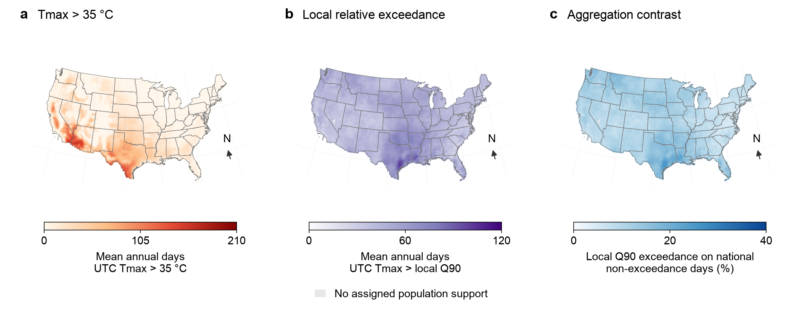
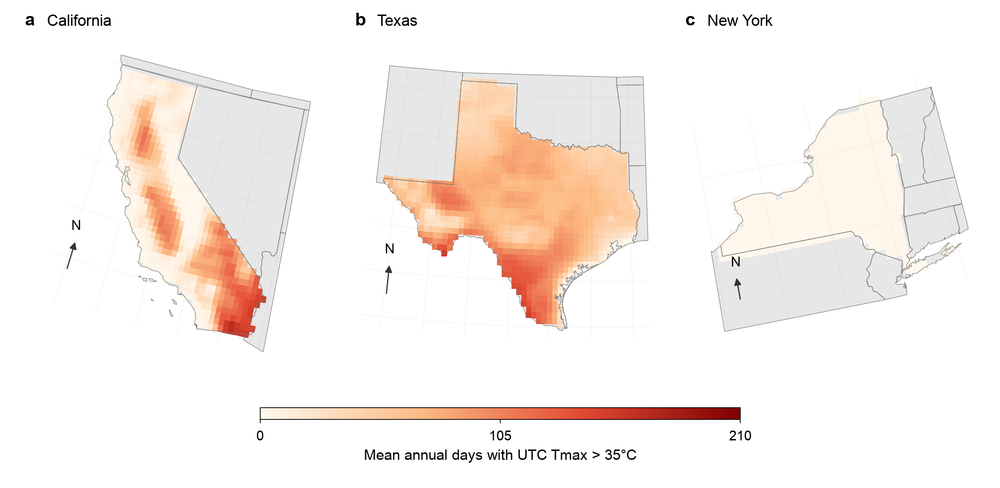
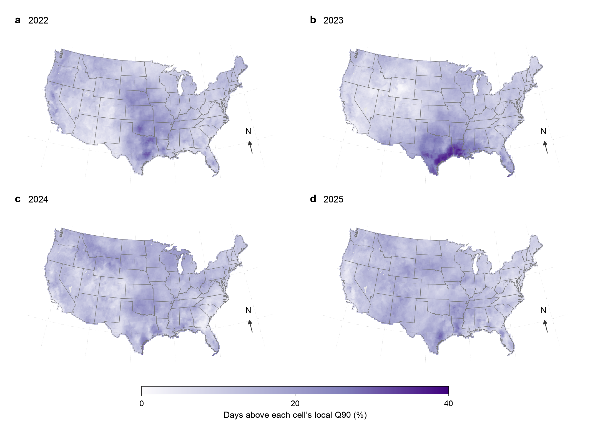
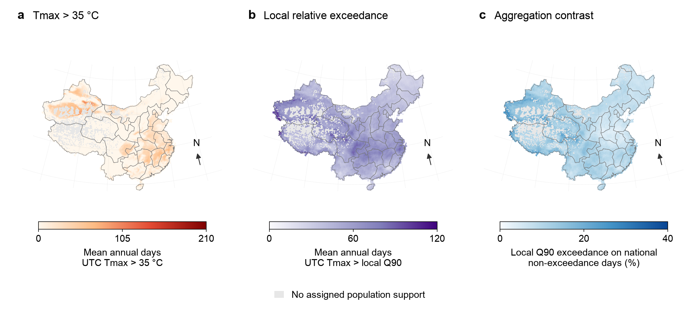
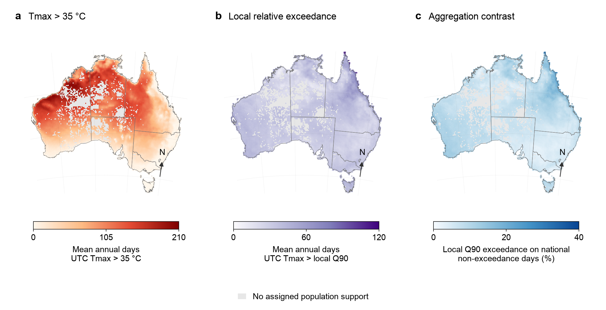

# HeatSignal 区域地图补充包 · 2026-11-02

新增 **5组、16幅地图面板**：美国本土、中国、澳大利亚各3种口径，美国2022–2025逐年对照，以及加州/得州/纽约州放大。来自Judy现有ERA5的37,206个原始0.25°正人口权重格点，未下载新数据。本文是描述性天气补充；原论文主模型、事件和结论保持冻结。

## 先看美国



从左到右分别为年均UTC日最高温严格超过35°C的天数、超过各格点自身Q90的年均天数，以及全国温度指数未过其Q90时、该格点仍超过自身Q90的百分比。三者不能互相替代。所有国家同一指标共用同一线性色标，未截掉极端值。

**美国南部/西南的绝对高温日更多。** 在预设经纬度分区及9组邻近切分下，西南象限比东北象限多40.03–51.38天/年（按原固定人口权重在各显示子区内归一化）。额外0.5°/1°加权再汇总后方向仍正，全部27组切分/分辨率组合范围39.96–63.98天/年。这个范围是描述性分区敏感性范围，不是置信区间；“西南象限”不等同于美国官方统计区。

**相对自身历史的偏暖，没有稳定的西南—东北排序。** 原始网格下该差值随切分由−11.20到+10.20天/年变化。因此不能用绝对温度地图代替局地相对异常地图。Q90包括冷季偏暖，不能直接解释为危险高温。



加州显示网格有明显的沿海—内陆差异；得州南部更深；纽约州的35°C绝对过阈值日很少。三个州均使用原0.25°网格和相同0–210天/年色标；放大没有产生城市/街道精度。

| 显示州 | 州界内格点中心数 | 格点年均>35°C最小值 | 等格点中位数 | 最大值 |
|---|---:|---:|---:|---:|
| California / 加州 | 660 | 0 | 20.375 | 168.25 |
| Texas / 得州 | 1,049 | 0.25 | 67.50 | 154.25 |
| New York / 纽约州 | 230 | 0 | 0 | 2.25 |

上表是再分析网格描述，不是州居民暴露统计。州界使用保留的简化显示几何，按格点中心判断，边界格点归属近似；邻州灰色表示本幅未显示其数据。纽约的低值也不能解释为没有城市热岛、湿热风险或连接故障。



所有年份使用同一局地2018–2021 Q90参照。图中2023年得州的深色区更集中；整个显示范围的人口加权过阈值日比例为2022年12.71%、2023年12.88%、2024年12.21%、2025年11.15%。全部四年保留，没有单调上升；四年比较不构成长期趋势估计。

## 中国和澳大利亚对照





原始网格的邻近纬度切分下，中国南部比北部多7.60–12.25个>35°C日/年；澳大利亚则北部更多，南部减北部为−20.40至−1.76天/年。美国的方向不能机械套到其他国家。

**地图颜色面积与人口总体统计差异很大。** 澳大利亚有正人口权重的网格，等格点平均为75.44个>35°C日/年；改用原固定人口权重后仅6.55天/年。等格点平均不是等面积平均，2025固定权重也不是逐年真实居民暴露。不能把图面大面积深色理解为大多数人口处在同等高温下。

| 显示范围 | 支持格点数 | 原全国固定权重覆盖 | 人口加权年均>35°C天数 | 人口加权年均局地Q90天数 | 全国指数未过阈值时局地Q90条件频率 |
|---|---:|---:|---:|---:|---:|
| 美国本土 | 13,673 | 98.3619% | 16.51 | 44.70 | 9.73% |
| CHN原权重范围 | 13,393 | 99.999996% | 18.22 | 53.44 | 8.42% |
| 澳大利亚 | 10,140 | 99.9868% | 6.55 | 36.24 | 7.19% |

这些是天气指标，不是断网率、设备失效阈值、因果效应或韧性排名。美国地图不含阿拉斯加/夏威夷，而全国条件仍沿用原完整国家指数。三国全国未过阈值的分母分别为1,301/1,177/1,323天。

全部四年的人口加权局地Q90过阈值日比例：

| 年 | 美国本土 | CHN原权重范围 | 澳大利亚 |
|---|---:|---:|---:|
| 2022 | 12.71% | 13.61% | 4.66% |
| 2023 | 12.88% | 14.99% | 11.49% |
| 2024 | 12.21% | 14.21% | 11.10% |
| 2025 | 11.15% | 15.71% | 12.45% |

## 文件与复现

- `figures/`：五组PNG、可编辑PDF/SVG，英文完整图注`captions.json`、州显示范围和颜色设计。
- `data/pixels.csv`：37,206格点、三种指标、全部年度和季节频率；`country_daily_subset.csv`保留全国逐日对照。11个NPZ是独立审计抽样，不是全部日值。
- `descriptive_profiles_v2.json`及`.cuts.csv`：所有三国和全部预设切分；`coarsening_sensitivity.*`保留0.25°/0.5°/1°全部243项比较。再汇总只用于敏感性检查，图仍为原始网格。
- `context_original/`：原保留geoBoundaries CGAZ ADM1显示子集；`context/`：本地GEOS检验后的显示几何。Queensland一个微小嵌套壳重叠，用各有效多边形的几何并集规范化，边界范围不变、度平方差约3.25×10⁻¹⁰；原文件保留。未改天气/权重，未推断历史行政边界或IODA ADM1映射。
- `methods/`：计算与显示口径；`verification/`：原始/派生输入核对、字体/矢量/原生图像审阅；`CHECKSUMS.json`：本补充包逐文件校验。
- `code/`：新增提取、审计、显示、profile和敏感性代码及8项单元测试。完整原始重提取需在Judy既有完整项目和原始输入上运行；本包可直接从冻结CSV重画地图。

在本包`code/`目录中，使用已有NumPy、pandas、Matplotlib、GeoPandas、PyProj、Shapely及Arial字体：

```sh
python3 -m unittest discover -s tests -p 'test_regional*.py'
python3 scripts/plot_regional_maps_20261102.py --data ../data/pixels.csv --boundaries ../context/adm1_orientation.geojson --output ../rebuilt_figures
python3 scripts/profile_regional_maps_20261102.py --data ../data/pixels.csv --output ../rebuilt_profiles.json
python3 -m scripts.check_regional_map_coarsening_20261102 --data ../data/pixels.csv --output ../rebuilt_coarsening.json
```

输出路径必须是新的，避免覆盖。图宽180mm、Arial≥7pt、300dpi；SVG保留文字/格点矢量，无嵌入栅格图。PDF/SVG元数据时间固定到2026-11-02日初以便复现，真实生产/审计时间另记。

## 核验边界

正式提取19.89分钟；独立审计86.79秒。抽样88格点×365天共32,120次标量Q90核对、968项独立指标计数、33次原始24小时探针，以及全部4,383个国家日的原全局人口比例边界核对通过。原始日最高温需24个有限UTC小时；Q90为2018–2021圆形日历±15日、线性分位数、至少112有限日且四年均有支持；参照剔除2月29日，目标闰日用相邻阈值插值。此短参照不冒充30年气候常态。缺失从不填零。

本次复用原ERA5全文件SHA账本，核查原文件尺寸/旧mtime和生产前后指纹稳定，另有逐块逐月解码子集新SHA；没有宣称重新对约200GB原文件全量算SHA。v1 pilot的JSON序列化缺陷和显示几何/图例重叠均保留失败中间版本并经回归核验修复；本包仅包含通过原生审阅的最终v4图。`figures/manifest.json`是绘制时的阶段记录，最终审阅状态见`verification/figures_and_data.json`。

独立目录复现：从本包复制后的CSV/几何/代码运行8项测试，并重新生成五组图，耗时19.58秒；全部15个PNG/PDF/SVG文件逐字节一致，profile和全部分辨率敏感性JSON也逐字节一致。见`verification/isolated_reproduction.json`。
